# THIẾT KẾ CƠ SỞ DỮ LIỆU KHÔNG GIAN & SƠ ĐỒ ERD (DATABASE ERD — 14 TABLES)
## Dự án: Hanoi PM2.5 GIS (PostgreSQL + PostGIS)

**Phiên bản:** 1.0 (Giai đoạn 1)  
**Hệ quản trị CSDL:** PostgreSQL 15+ với Extension `postgis` và `uuid-ossp` / `pgcrypto`  
**Múi giờ lưu trữ:** Chuẩn `TIMESTAMPTZ` (UTC); hiển thị tại ứng dụng theo `Asia/Bangkok` (`UTC+7`).

---

## 1. Sơ đồ Thực thể — Liên kết (Entity-Relationship Diagram — 14 Bảng Chính)

```mermaid
erDiagram
    data_sources ||--o{ monitoring_stations : "cung cấp"
    data_sources ||--o{ air_quality_model_runs : "chạy mô hình"
    data_sources ||--o{ ingestion_jobs : "đồng bộ từ"

    administrative_areas ||--o{ administrative_areas : "parent_id (Thành phố -> Quận/Huyện -> Xã/Phường)"
    administrative_areas ||--o{ monitoring_stations : "ST_Within (administrative_area_id)"
    administrative_areas ||--o{ air_quality_alerts : "cảnh báo tại vùng"

    monitoring_stations ||--o{ sensors : "sở hữu cảm biến"
    monitoring_stations ||--o{ weather_data : "khí tượng tại trạm (tùy chọn)"
    monitoring_stations ||--o{ air_quality_alerts : "cảnh báo tại trạm"
    monitoring_stations ||--o{ user_favorite_locations : "trạm gắn kèm"

    sensors ||--o{ pm25_observations : "ghi nhận số đo"

    air_quality_model_runs ||--o{ model_pm25_values : "sinh ra dự báo/mô hình"
    model_grid_cells ||--o{ model_pm25_values : "tại ô lưới"
    model_grid_cells ||--o{ weather_data : "khí tượng tại ô lưới"

    users ||--o{ user_favorite_locations : "lưu địa điểm"
    users ||--o{ audit_logs : "thực hiện thao tác"

    data_sources {
        uuid id PK
        varchar code UK "OPENAQ_V3, WAQI, OPEN_METEO_CAMS, OPEN_METEO_WX, ADMIN_IMPORT"
        varchar name
        varchar source_type "OBSERVATION, AQI_INDEX, NUMERICAL_MODEL, WEATHER, GIS"
        varchar base_url
        varchar license
        integer poll_interval_minutes
        boolean is_active
        timestamptz last_success_at
        varchar last_status "HEALTHY, DEGRADED, DOWN"
    }

    administrative_areas {
        uuid id PK
        varchar code UK "Mã hành chính GSO / OCHA"
        varchar name_vi "Tên tiếng Việt (VD: Phường Bạch Mai)"
        varchar name_en "Tên tiếng Anh"
        smallint admin_level "1=Thành phố, 2=Quận/Huyện, 3=Xã/Phường"
        uuid parent_id FK
        geometry geom "MultiPolygon, SRID 4326 (GIST Index)"
        geometry centroid "Point, SRID 4326"
        numeric area_sq_km
        date effective_date "Ngày hiệu lực địa giới"
        varchar source_dataset
    }

    monitoring_stations {
        uuid id PK
        uuid data_source_id FK
        varchar external_station_id "ID trạm gốc (VD: 4946812 trên OpenAQ)"
        varchar name "Tên trạm (VD: Công viên Nhân Chính - Khuất Duy Tiến)"
        varchar provider_name "Hanoi Air Quality Monitoring Network, AirGradient..."
        varchar equipment_grade "REFERENCE_GRADE, LOW_COST_SENSOR"
        boolean is_reference_monitor
        geometry geom "Point, SRID 4326 (GIST Index)"
        double_precision latitude
        double_precision longitude
        uuid administrative_area_id FK
        boolean is_within_hanoi "Kết quả kiểm tra ST_Within với ranh giới Hà Nội"
        varchar freshness_status "FRESH, DELAYED, STALE, UNAVAILABLE"
        timestamptz first_observed_at
        timestamptz last_observed_at
    }

    sensors {
        uuid id PK
        uuid station_id FK
        varchar external_sensor_id "ID cảm biến gốc (VD: 13502151)"
        varchar parameter_code "pm25, pm10, co, no2, so2, o3"
        varchar unit "ug/m3, aqi_us"
        varchar averaging_period "1h, 15m, instant"
        boolean is_active
    }

    pm25_observations {
        bigserial id PK
        uuid sensor_id FK
        uuid station_id FK
        uuid ingestion_job_id FK
        double_precision pm25_ugm3 "Nồng độ PM2.5 chuẩn hóa (µg/m³) — NULL nếu chỉ có AQI"
        double_precision pm10_ugm3 "Nồng độ PM10 nếu có (µg/m³)"
        integer raw_aqi_subindex "Chỉ số con AQI gốc (Dành cho nguồn WAQI)"
        double_precision raw_value "Giá trị gốc không chỉnh sửa"
        varchar value_origin "DIRECT_CONCENTRATION, DERIVED_FROM_US_AQI"
        varchar quality_flag "VALID, HIGH_EXTREME, SUSPECT_SPIKE, INVALID_*"
        timestamptz measured_at_utc "1. Thời điểm trạm đo"
        timestamptz published_at_utc "2. Thời điểm nguồn công bố"
        timestamptz fetched_at_utc "3. Thời điểm backend thu thập"
        timestamptz stored_at_utc "4. Thời điểm DB lưu"
        jsonb raw_payload
    }

    air_quality_model_runs {
        uuid id PK
        uuid data_source_id FK
        varchar model_name "CAMS_GLOBAL_ECMWF"
        double_precision spatial_resolution_deg "0.4 (tương đương ~40 km)"
        timestamptz run_initialized_at_utc
        timestamptz fetched_at_utc
        integer forecast_horizon_hours
    }

    model_grid_cells {
        uuid id PK
        varchar cell_code UK "Mã ô lưới (VD: CAMS_21.00_105.90)"
        double_precision center_lat
        double_precision center_lon
        double_precision resolution_deg "0.4"
        geometry cell_polygon "Polygon ô lưới, SRID 4326 (GIST Index)"
        geometry center_point "Point tâm ô lưới, SRID 4326"
    }

    model_pm25_values {
        bigserial id PK
        uuid model_run_id FK
        uuid grid_cell_id FK
        timestamptz valid_at_utc "Mốc thời gian dự báo/mô hình có hiệu lực"
        boolean is_forecast "false=quá khứ/hiện tại, true=dự báo tương lai"
        double_precision pm25_ugm3
        double_precision pm10_ugm3
        integer us_aqi
        integer european_aqi
    }

    weather_data {
        bigserial id PK
        uuid data_source_id FK
        uuid grid_cell_id FK
        uuid station_id FK
        geometry geom "Point, SRID 4326 (GIST Index)"
        timestamptz observed_at_utc
        boolean is_forecast
        double_precision temperature_c "Nhiệt độ 2m (°C)"
        double_precision relative_humidity_pct "Độ ẩm tương đối (%)"
        double_precision wind_speed_kmh "Tốc độ gió 10m (km/h)"
        double_precision wind_direction_deg "Hướng gió 10m (0-360°)"
        double_precision precipitation_mm "Lượng mưa (mm)"
        double_precision surface_pressure_hpa "Áp suất bề mặt (hPa)"
    }

    air_quality_alerts {
        uuid id PK
        varchar alert_category "PM25_CONCENTRATION, AQI_THRESHOLD, MODEL_FORECAST, STATION_STALE, DATA_ANOMALY"
        varchar severity "GOOD, MODERATE, UNHEALTHY_SENSITIVE, UNHEALTHY, VERY_UNHEALTHY, HAZARDOUS, TECHNICAL_WARNING"
        uuid station_id FK
        uuid administrative_area_id FK
        varchar data_origin "OBSERVED, MODELED"
        double_precision trigger_value
        double_precision threshold_value
        varchar unit "ug/m3, VN_AQI, US_AQI, minutes"
        varchar deduplication_key UK "Chống tạo cảnh báo trùng trong cùng chu kỳ"
        varchar status "ACTIVE, ACKNOWLEDGED, RESOLVED"
        text title_vi
        text message_vi
        timestamptz triggered_at_utc
        timestamptz resolved_at_utc
    }

    ingestion_jobs {
        uuid id PK
        uuid data_source_id FK
        varchar trigger_type "SCHEDULER, CRON_WEBHOOK, MANUAL_ADMIN"
        varchar status "RUNNING, SUCCESS, PARTIAL_SUCCESS, FAILED"
        integer records_fetched
        integer records_inserted
        integer records_flagged_qc
        integer duration_ms
        text error_message
        timestamptz started_at_utc
        timestamptz finished_at_utc
    }

    users {
        uuid id PK
        varchar email UK
        varchar password_hash
        varchar full_name
        varchar role "USER, ADMIN"
        boolean is_active
        timestamptz created_at_utc
        timestamptz last_login_at_utc
    }

    user_favorite_locations {
        uuid id PK
        uuid user_id FK
        varchar label_name "Nhà riêng, Trường học, Cơ quan..."
        geometry geom "Point, SRID 4326 (GIST Index)"
        double_precision latitude
        double_precision longitude
        uuid nearest_station_id FK
        uuid administrative_area_id FK
        double_precision custom_pm25_threshold_ugm3 "Ngưỡng cảnh báo cá nhân (VD: 35.0)"
        boolean enable_alert
        timestamptz created_at_utc
    }

    audit_logs {
        bigserial id PK
        uuid actor_user_id FK
        varchar action_type "CREATE_STATION, UPDATE_SOURCE, OVERRIDE_QC_FLAG, IMPORT_DATA"
        varchar target_table
        varchar target_id
        jsonb old_values
        jsonb new_values
        text reason
        varchar ip_address
        timestamptz created_at_utc
    }
```



---

## 2. Thiết kế Chỉ mục Không gian (Spatial Indexes) & Ràng buộc Toàn vẹn

Để đảm bảo truy vấn không gian và chuỗi thời gian đạt tốc độ tối ưu, cơ sở dữ liệu bắt buộc khai báo các chỉ mục sau trong file migration:

```sql
-- 1. Kích hoạt PostGIS
CREATE EXTENSION IF NOT EXISTS postgis;
CREATE EXTENSION IF NOT EXISTS pgcrypto;

-- 2. Chỉ mục Không gian GIST (Spatial Indexes)
CREATE INDEX idx_admin_areas_geom_gist ON administrative_areas USING GIST (geom);
CREATE INDEX idx_admin_areas_geog_gist ON administrative_areas USING GIST ((geom::geography));

CREATE INDEX idx_stations_geom_gist ON monitoring_stations USING GIST (geom);
CREATE INDEX idx_stations_geog_gist ON monitoring_stations USING GIST ((geom::geography));

CREATE INDEX idx_model_cells_poly_gist ON model_grid_cells USING GIST (cell_polygon);
CREATE INDEX idx_weather_geom_gist ON weather_data USING GIST (geom);
CREATE INDEX idx_fav_locations_geom_gist ON user_favorite_locations USING GIST (geom);

-- 3. Ràng buộc Chống trùng lặp (Deduplication Unique Constraints)
ALTER TABLE monitoring_stations
  ADD CONSTRAINT uq_station_source_external UNIQUE (data_source_id, external_station_id);

ALTER TABLE pm25_observations
  ADD CONSTRAINT uq_observation_sensor_time UNIQUE (sensor_id, measured_at_utc);

ALTER TABLE model_pm25_values
  ADD CONSTRAINT uq_model_cell_valid_time UNIQUE (model_run_id, grid_cell_id, valid_at_utc);

-- 4. Chỉ mục Chuỗi thời gian (Time-Series BTREE Indexes)
CREATE INDEX idx_pm25_obs_station_time_desc ON pm25_observations (station_id, measured_at_utc DESC);
CREATE INDEX idx_pm25_obs_valid_time_desc ON pm25_observations (measured_at_utc DESC) WHERE quality_flag = 'VALID';
CREATE INDEX idx_model_values_valid_time ON model_pm25_values (valid_at_utc DESC, grid_cell_id);
CREATE INDEX idx_weather_observed_time ON weather_data (observed_at_utc DESC);
```

