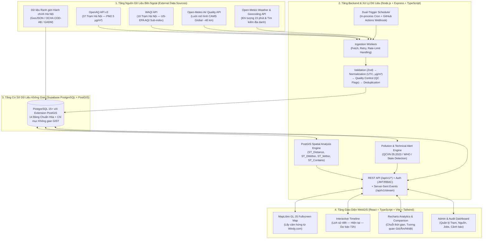
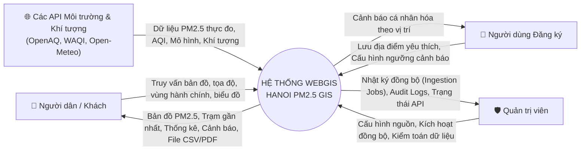
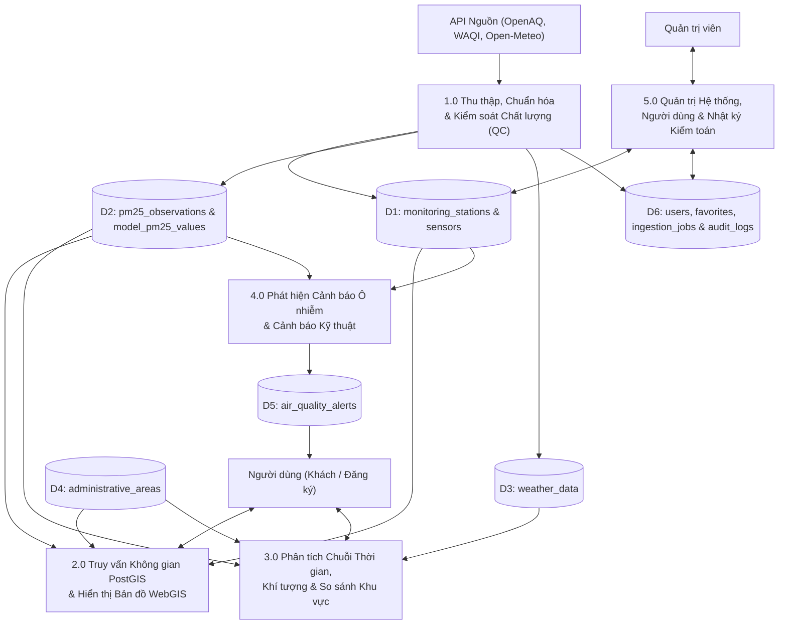

# KIẾN TRÚC HỆ THỐNG VÀ SƠ ĐỒ LUỒNG DỮ LIỆU (SYSTEM ARCHITECTURE & DFD)
## Dự án: Hanoi PM2.5 GIS

**Phiên bản:** 1.0 (Giai đoạn 1)  
**Ngày cập nhật:** 28/10/2026

---

## 1. Sơ đồ Kiến trúc Tổng thể Hệ thống (High-Level System Architecture)

---

## 2. Sơ đồ Luồng Dữ liệu — DFD Mức Ngữ Cảnh (Context Diagram — DFD Level 0)

---

## 3. Sơ đồ Luồng Dữ liệu — DFD Mức 1 (DFD Level 1 — Các Tiến trình Cốt lõi)

---

## 4. Nguyên tắc Phân tách Mô-đun (Modular Separation Principles)

Trong thư mục `apps/api/src/modules/`, hệ thống được chia thành 6 module độc lập, giao tiếp qua tầng Service rõ ràng:
1. `ingestion/`: Chứa các adapter kết nối `OpenAqAdapter`, `WaqiAdapter`, `OpenMeteoAqAdapter`, `OpenMeteoWeatherAdapter`, cùng bộ `QualityControlPipeline`.
2. `gis/`: Chứa các hàm truy vấn không gian thuần PostGIS (`findNearestStations`, `findStationsWithinRadius`, `findAdministrativeAreaByPoint`, `getAreaStatistics`, `filterByBoundingBox`).
3. `monitoring/`: Phục vụ dữ liệu PM2.5 mới nhất, lịch sử trạm, lưới mô hình và timeline.
4. `analytics/`: Xử lý tổng hợp thời gian (theo giờ/ngày), tính hệ số tương quan khí tượng Pearson $r$, so sánh đa trạm và xuất CSV/PDF.
5. `alerts/`: Động cơ quy tắc phát hiện vượt ngưỡng QCVN 05:2023/BTNMT, WHO và phát hiện trạm mất tín hiệu (`STALE`/`UNAVAILABLE`).
6. `admin/`: Quản lý người dùng, phân quyền JWT, nhật ký `ingestion_jobs` và `audit_logs`.

