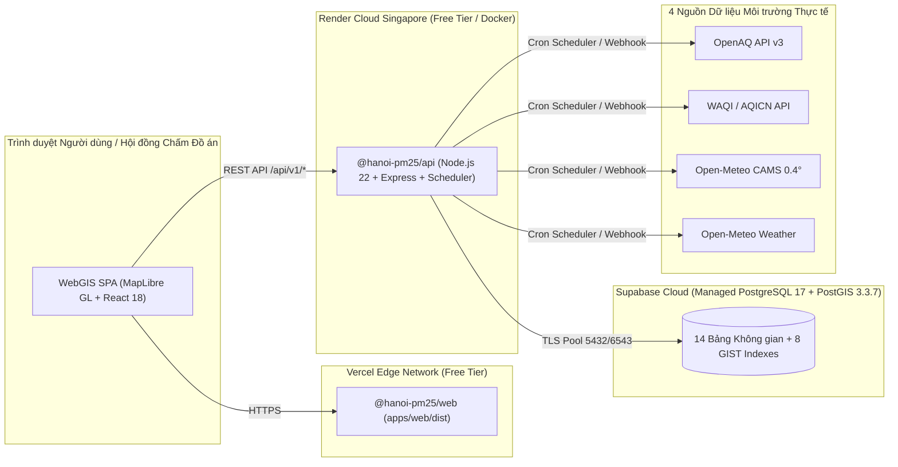

# HƯỚNG DẪN TRIỂN KHAI CLOUD CÔNG KHAI VÀ VẬN HÀNH HỆ THỐNG
## Dự án: Hanoi PM2.5 WebGIS (`docs/deployment/DEPLOYMENT_AND_OPERATIONS_GUIDE.md`)

---

## 1. Kiến trúc Triển khai Miễn phí cho Sinh viên (Zero-Cost Student Cloud Stack)

Hệ thống được thiết kế để triển khai công khai 100% miễn phí trên 3 nền tảng đám mây chuẩn công nghiệp:



---

## 2. Vận hành Trực tiếp trên Máy tính Cá nhân (Windows Local Development)

### 2.1. Khởi chạy Hệ thống Full-Stack
Tại thư mục gốc `c:\Users\ADMIN\Documents\DALN`:

1. **Cửa sổ Terminal 1 — Khởi chạy Backend PostGIS API (`http://localhost:4000`):**
   ```powershell
   npm run dev:api
   ```
   - Kiểm tra kết nối cơ sở dữ liệu: truy cập `http://localhost:4000/api/health`

2. **Cửa sổ Terminal 2 — Khởi chạy Giao diện Bản đồ WebGIS (`http://localhost:5173`):**
   ```powershell
   npm run dev:web
   ```
   - Mở trình duyệt tại: **http://localhost:5173**

### 2.2. Các Lệnh Quản trị & Kiểm chứng Dữ liệu Thực tế
- **Khởi tạo / Kiểm chứng 14 bảng & 8 chỉ mục GIST trên Supabase PostGIS:**
  ```powershell
  npm run db:migrate
  ```
- **Chạy thu thập dữ liệu thực tế tức thời từ 4 nguồn công khai (OpenAQ v3, WAQI, CAMS, Weather):**
  ```powershell
  npm run ingest:now
  ```
- **Đo kiểm hiệu năng truy vấn không gian PostGIS (`EXPLAIN ANALYZE`):**
  ```powershell
  npm run benchmark:postgis
  ```
- **Chạy toàn bộ 25 bài kiểm thử tự động (Unit + Store + PostGIS Integration + Security):**
  ```powershell
  npm test
  ```

---

## 3. Hướng dẫn Triển khai Công khai lên Internet (Vercel + Render + Supabase)

### Bước 1: Đẩy mã nguồn lên GitHub (An toàn tuyệt đối cho API Key)
- Tệp `.gitignore` đã loại trừ hoàn toàn `.env`, đảm bảo `DATABASE_URL`, `OPENAQ_API_KEY`, và `WAQI_API_TOKEN` **không bao giờ bị đẩy lên GitHub**.
- Đẩy nhánh `main` lên kho lưu trữ GitHub cá nhân của bạn.

### Bước 2: Triển khai Backend (`@hanoi-pm25/api`) lên Render.com
1. Đăng nhập https://dashboard.render.com/ bằng tài khoản GitHub.
2. Chọn **New +** -> **Blueprint** (hoặc **Web Service**) và chọn kho lưu trữ GitHub của dự án.
3. Render sẽ tự động đọc tệp [`render.yaml`](../../render.yaml) ở thư mục gốc:
   - **Build Command:** `npm install && npm run build:shared && npm run build:api`
   - **Start Command:** `npm run start:api`
   - **Health Check Path:** `/api/health`
4. Trong mục **Environment Variables** của Render, điền 3 biến lấy từ tệp `.env` trên máy của bạn:
   - `DATABASE_URL`: Chuỗi kết nối Supabase PostgreSQL
   - `OPENAQ_API_KEY`: Khóa API OpenAQ v3
   - `WAQI_API_TOKEN`: Token WAQI API
   - `CORS_ORIGIN`: `*` (hoặc tên miền Vercel của bạn, ví dụ `https://hanoi-pm25-gis.vercel.app`)
5. Sau khi Render báo `Live`, bạn sẽ nhận được URL Backend, ví dụ: `https://hanoi-pm25-api.onrender.com`.

### Bước 3: Triển khai Frontend (`@hanoi-pm25/web`) lên Vercel.com
1. Đăng nhập https://vercel.com/ bằng tài khoản GitHub.
2. Chọn **Add New...** -> **Project** và chọn kho lưu trữ GitHub của dự án.
3. Vercel sẽ tự động nhận diện cấu hình từ tệp [`vercel.json`](../../vercel.json):
   - **Build Command:** `npm run build:web`
   - **Output Directory:** `apps/web/dist`
4. Thêm 1 biến môi trường (Environment Variable) trên Vercel:
   - `VITE_API_BASE_URL`: `https://hanoi-pm25-api.onrender.com/api`
5. Nhấn **Deploy**. Chỉ sau ~45 giây, website WebGIS của bạn sẽ có đường dẫn HTTPS công khai để trình diễn trực tiếp trước Hội đồng Bảo vệ Đồ án.

---

## 4. Triển khai Dự phòng bằng Docker Compose (`docker-compose.yml`)

Trong trường hợp phòng bảo vệ đồ án mất kết nối Internet quốc tế tới Supabase Cloud, bạn có thể khởi chạy toàn bộ cụm PostgreSQL 16 + PostGIS 3.4 và Backend API ngay trên máy cá nhân bằng Docker Desktop:

```powershell
docker compose up -d --build
```
Container `hanoi-pm25-postgis` sẽ tự động chạy [`001_init_postgis_schema.sql`](../../database/migrations/001_init_postgis_schema.sql) và [`001_seed_hanoi_base.sql`](../../database/seeds/001_seed_hanoi_base.sql) ngay khi khởi tạo lần đầu.
