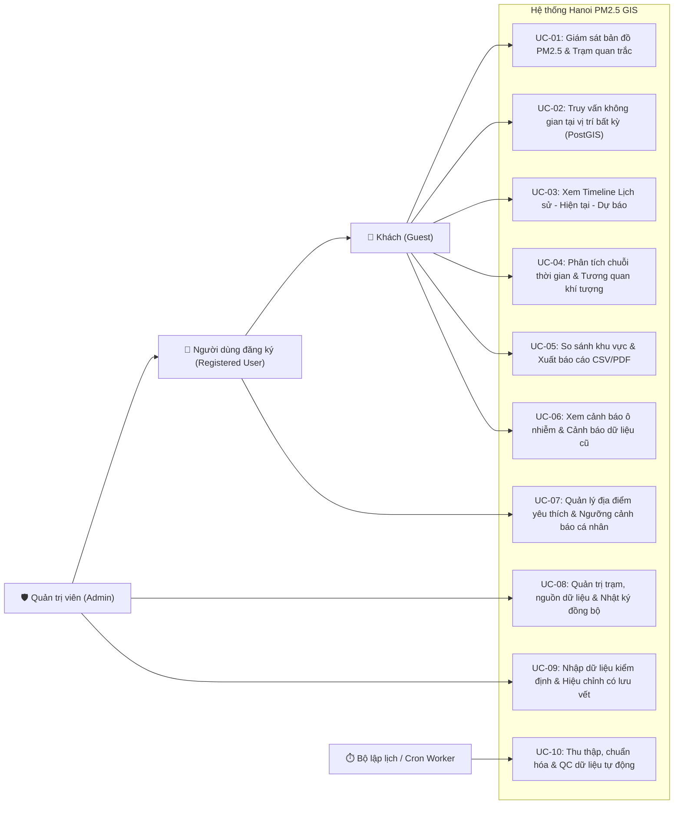

# CA SỬ DỤNG, CÂU CHUYỆN NGƯỜI DÙNG VÀ TIÊU CHÍ NGHIỆM THU
## (USE CASES, USER STORIES & ACCEPTANCE CRITERIA)
## Dự án: Hanoi PM2.5 GIS

**Phiên bản:** 1.0 (Giai đoạn 1)  
**Ngày cập nhật:** 28/10/2026

---

## 1. Sơ đồ Tổng quan Ca sử dụng (Use Case Diagram)

---

## 2. Danh sách Câu chuyện Người dùng & Tiêu chí Nghiệm thu (User Stories & Acceptance Criteria)

### US-01: Giám sát trực quan PM2.5 toàn Thành phố Hà Nội (Vai trò: Khách)
- **User Story:** *Là một người dân Hà Nội, tôi muốn mở trang web lên là thấy ngay bản đồ toàn màn hình hiển thị nồng độ bụi mịn PM2.5 tại các trạm quan trắc thực tế và lớp lưới mô hình khu vực, để biết ngay chất lượng không khí hiện tại ở nơi mình sinh sống.*
- **Tiêu chí nghiệm thu (Acceptance Criteria):**
  - `AC-01.1`: Bản đồ tự động căn giữa tại Hà Nội và hiển thị lớp PM2.5 làm lớp mặc định.
  - `AC-01.2`: Các trạm đang hoạt động (`FRESH`, ví dụ *Công viên Nhân Chính - Khuất Duy Tiến* `33.6 µg/m³`, *ĐHBK Giải Phóng* `44.28 µg/m³`, *Dragon Gia Lâm* `49.4 µg/m³`) hiển thị nổi bật với màu sắc đúng thang nồng độ PM2.5.
  - `AC-01.3`: Các trạm có dữ liệu trễ (`STALE`, ví dụ *46 Lưu Quang Vũ* và *Minh Khai - Bắc Từ Liêm* đo lúc `08:00`) hiển thị kèm nhãn cảnh báo dữ liệu cũ; các trạm ngừng phát tín hiệu (`UNAVAILABLE`) có thể bật/tắt qua bộ lọc để tra cứu lịch sử.
  - `AC-01.4`: Có bảng chú giải màu (Legend) ghi rõ đơn vị `µg/m³` và phân biệt rõ **Điểm đo thực tế** với **Lớp mô hình CAMS Global (~40 km)**.

### US-02: Truy vấn thông tin tại một vị trí bất kỳ trên bản đồ Hà Nội (Vai trò: Khách)
- **User Story:** *Là một người dùng ở huyện ngoại thành (ví dụ Sóc Sơn hoặc Chương Mỹ), khi tôi nhấp chuột vào vị trí nhà mình trên bản đồ (nơi không có trạm đo trực tiếp), tôi muốn biết vị trí đó thuộc xã/phường nào, cách trạm quan trắc thực tế gần nhất bao nhiêu km, và giá trị mô hình ước tính tại khu vực đó là bao nhiêu.*
- **Tiêu chí nghiệm thu (Acceptance Criteria):**
  - `AC-02.1`: Hệ thống dùng PostGIS `ST_Contains` trả về đúng tên đơn vị hành chính chứa điểm nhấp chuột.
  - `AC-02.2`: Hệ thống dùng PostGIS `ST_Distance` tìm trạm quan trắc đang hoạt động gần nhất, hiển thị khoảng cách theo km (làm tròn 2 chữ số thập phân) và dòng cảnh báo rõ ràng: *"Đây là số đo tại trạm gần nhất (cách X km), không phải số đo trực tiếp tại vị trí bạn chọn"*.
  - `AC-02.3`: Hiển thị tách biệt giá trị ước tính từ mô hình CAMS Global (`pm2_5`, `pm10`) và điều kiện thời tiết hiện tại (`nhiệt độ`, `độ ẩm`, `gió`) tại ô lưới chứa điểm đó.

### US-03: Phân tích tương quan giữa Khí tượng và Bụi mịn PM2.5 (Vai trò: Nhà nghiên cứu / Sinh viên)
- **User Story:** *Là một người nghiên cứu môi trường, tôi muốn xem biểu đồ biến thiên PM2.5 cùng với tốc độ gió, hướng gió, độ ẩm và nhiệt độ theo thời gian, để phân tích hiện tượng bụi mịn tích tụ khi lặng gió hoặc giảm xuống khi có mưa/gió mùa.*
- **Tiêu chí nghiệm thu (Acceptance Criteria):**
  - `AC-03.1`: Hỗ trợ chọn khoảng thời gian (24 giờ, 7 ngày, 30 ngày, tùy chỉnh) và vẽ biểu đồ tương quan giữa PM2.5 (`µg/m³`) với từng yếu tố khí tượng.
  - `AC-03.2`: Tính toán và hiển thị hệ số tương quan Pearson $r$ kèm chú thích khoa học: *"Tương quan thống kê không đồng nghĩa với quan hệ nhân quả trực tiếp"*.

### US-04: Theo dõi Cảnh báo Ô nhiễm & Lưu địa điểm yêu thích (Vai trò: Người dùng đăng ký)
- **User Story:** *Là một người dùng đã đăng nhập, tôi muốn lưu vị trí nhà riêng và trường học vào danh sách yêu thích và đặt ngưỡng cảnh báo PM2.5 cá nhân (ví dụ `> 35 µg/m³`), để nhận thông báo ngay trên giao diện khi nồng độ bụi mịn vượt ngưỡng.*
- **Tiêu chí nghiệm thu (Acceptance Criteria):**
  - `AC-04.1`: Người dùng có thể đăng ký, đăng nhập và thêm/xóa địa điểm yêu thích (tọa độ `POINT` lưu trong PostGIS).
  - `AC-04.2`: Hệ thống đối chiếu dữ liệu mới nhất với ngưỡng cảnh báo chung (QCVN 05:2023/BTNMT, WHO) và ngưỡng cá nhân để hiển thị thông báo mà không tạo cảnh báo trùng lặp trong cùng một chu kỳ đo.

### US-05: Quản trị nguồn dữ liệu, theo dõi đồng bộ và kiểm toán (Vai trò: Quản trị viên)
- **User Story:** *Là quản trị viên hệ thống, tôi muốn xem trạng thái hoạt động của các nguồn API (`OpenAQ`, `WAQI`, `Open-Meteo`), kích hoạt đồng bộ thủ công khi cần, và xem nhật ký `ingestion_jobs` để biết mỗi lần đồng bộ thu thập được bao nhiêu bản ghi hợp lệ hoặc lỗi.*
- **Tiêu chí nghiệm thu (Acceptance Criteria):**
  - `AC-05.1`: Trang Dashboard Quản trị yêu cầu xác thực JWT với quyền `ADMIN`.
  - `AC-05.2`: Hiển thị bảng lịch sử các lần chạy worker (`ingestion_jobs`), số lượng bản ghi thu thập, số bản ghi bị gắn cờ QC, và thời gian phản hồi của từng API.
  - `AC-05.3`: Quản trị viên không thể sửa trực tiếp cột `raw_value`; mọi thao tác đánh dấu chất lượng dữ liệu đều tạo bản ghi trong `audit_logs`.

